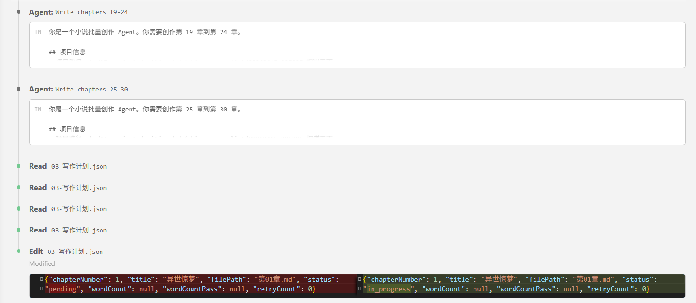
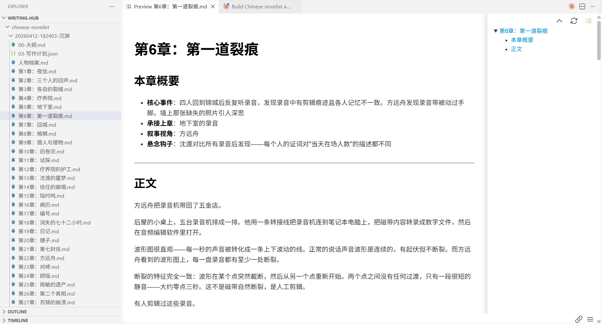
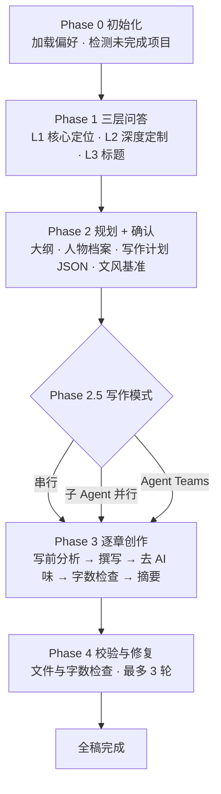

<div align="center">

# chinese-novelist · WorkBuddy 适配版

### 让 AI 为你写完一整部中文小说

[](../../releases)
[](https://www.workbuddy.cn)
[](LICENSE)

上游版本：[PenglongHuang/chinese-novelist-skill](https://github.com/PenglongHuang/chinese-novelist-skill) · `v2.3.2`（`f9dc39d`）

</div>

> **这是 fork，不是原项目。**
>
> 创作流程、写作规则和参考资料来自上游（MIT 许可），本仓库只做一件事：**把 Agent Teams 等能力落到 WorkBuddy 的实际工具上**。写作用的规则和上游保持一致，因此上游每次发版都能低成本同步过来。

---

## 目录

- [它解决什么问题](#它解决什么问题)
- [这个 fork 改了什么](#这个-fork-改了什么)
- [快速开始](#快速开始)
- [兼容性](#兼容性)
- [使用过程](#使用过程)
- [创作记忆](#创作记忆)
- [创作流程](#创作流程)
- [输出结构](#输出结构)
- [字数检查脚本](#字数检查脚本)
- [常见问题](#常见问题)
- [内置参考资料](#内置参考资料)
- [与上游同步](#与上游同步)
- [致谢与许可](#致谢与许可)

---

## 它解决什么问题

脑子里有个故事，却总卡在“然后呢”？

这个 Skill 让 Agent 按「问答定方向 → 出大纲 → 逐章写 → 自动校验」走完一部长篇，而不是写两章就散架：

| 能力 | 说明 |
|------|------|
| **三层递进问答** | 核心定位必答 3 问，深度定制可选 5 问，支持随机生成或整段跳过 |
| **创作记忆** | 记住你偏好的题材、视角和文风，下次少问几轮 |
| **中断续写** | 意外中断后重开对话即可，自动从断点章节继续 |
| **三种写作模式** | 串行 / 子 Agent 并行 / Agent Teams，按篇幅和环境选 |
| **自动校验** | 逐章审读连贯性，脚本校验字数，不合格章节最多重写 3 轮 |
| **章节衔接** | 摘要记录「事件后果 + 人物当前处境 + 未了事项」，后章不靠猜 |

---

## 这个 fork 改了什么

写作流程只改了 **4 个文件**，其余 **23 个文件与上游 `v2.3.2` 逐字节一致**；另外重写了 README / ROADMAP。

| 改动点 | 上游写法 | 本 fork |
|--------|----------|---------|
| **Agent Teams 实现** | 抽象描述（“用环境提供的团队/任务机制”） | 落到 WorkBuddy Agent 工具：`team_name` 组队、`SendMessage` 通讯、`bypassPermissions` 免确认、`max_turns` 防失控 |
| **写作模式选择** | 需手动开启的通用说明 | 直接给出 WorkBuddy 的派生参数与成员 prompt |
| **字数脚本路径** | `~/.claude/skills/...` | `~/.workbuddy/skills/chinese-novelist-workbuddy/...` |
| **安装方式** | `npx skills add` | 放进 WorkBuddy 技能目录（见下一节） |

适配涉及的流程文件（共 4 个）：

```
SKILL.md
references/flows/phase2-planning.md
references/flows/phase3-writing.md
references/flows/shared-infrastructure.md
```

> 换句话说：**上游负责写得更好，本 fork 负责在 WorkBuddy 里跑得起来。** 如果你用的是 Claude Code / Codex / Cursor，请直接用[上游仓库](https://github.com/PenglongHuang/chinese-novelist-skill)。

---

## 快速开始

### 1. 安装

把整个目录放进 WorkBuddy 的技能目录：

```bash
# 用户级：所有项目可用
~/.workbuddy/skills/chinese-novelist-workbuddy/

# 项目级：仅当前项目可用
<项目根目录>/.workbuddy/skills/chinese-novelist-workbuddy/
```

Windows 下用户级目录是 `C:\Users\<你的用户名>\.workbuddy\skills\`。

放入后新开一个会话，WorkBuddy 会按 `SKILL.md` 的 `description` 自动匹配。

### 2. 触发

```
使用 chinese-novelist 帮我写一部小说
```

写一段你想看的故事方向即可，剩下的问答由 Skill 引导。

### 3. 升级 / 卸载

- **升级**：用仓库最新内容覆盖整个技能目录，已写的小说不会被影响（它们在 `./chinese-novelist/` 下）
- **卸载**：删除该技能目录即可

---

## 兼容性

三种写作模式对宿主能力的要求不同，达不到就自动降级，不会失败：

| 能力要求 | 串行 | 子 Agent 并行 | Agent Teams |
|----------|------|---------------|-------------|
| 单 Agent 即可 | ✅ | — | — |
| 需要派生子 Agent | — | ✅ | ✅ |
| 需要 Agent 间通讯 | — | — | ✅ |
| 中断续写 | ✅ | ✅ | ✅ |
| 适用篇幅 | 短中篇 / 求稳 | 中长篇 / 求快 | 长篇 / 多线并进 |

本 fork 的 Agent Teams 按 WorkBuddy 的 `team_name` + `SendMessage` 实现；宿主不具备团队能力时，`phase3-writing.md` 会回退到「子 Agent 并行」，创作质量不受影响。

字数脚本依赖 **Node.js ≥ 16**（零依赖，无需安装任何 npm 包）。

---

## 使用过程

<table>
  <tr>
    <td align="center"><b>Phase 1 — 交互问答</b></td>
    <td align="center"><b>Phase 2 — 规划确认</b></td>
  </tr>
  <tr>
    <td></td>
    <td></td>
  </tr>
  <tr>
    <td align="center"><b>Phase 3 — 逐章创作</b></td>
    <td align="center"><b>Phase 4 — 完稿输出</b></td>
  </tr>
  <tr>
    <td></td>
    <td></td>
  </tr>
</table>

---

## 创作记忆

偏好保存在 `user-preferences.json`，跨项目复用：题材类型、叙事风格、章节数量倾向、文字密度。第二次创作时，已确认过的习惯不再追问。

<p align="center">
  
</p>

---

## 创作流程



### Phase 0：初始化

读取 `user-preferences.json`，扫描是否有 `in_progress` 章节可续写，给出个性化开场。

### Phase 1：三层问答

- **Layer 1（必答，3 问）**：题材创意、主角设定、核心冲突
- **Layer 2（可跳过，5 问）**：世界观、叙事视角、核心主题、读者定位、章节数量
- **Layer 3**：根据创意元素生成候选标题，选一个或自定义

每个问题都能随机生成，也能直接说「跳过」「都用默认」。

### Phase 2：规划 + 确认

生成 `01-大纲.md`（含设定与事实词典）、`00-人物档案.md`、`03-文风基准.md`、`02-写作计划.json`，展示给你确认后才动笔。

### Phase 2.5：选择写作模式

确认规划后选择串行、子 Agent 并行或 Agent Teams。

### Phase 3：逐章创作

进入后不再逐章确认，按 [chapter-checklist.md](references/flows/chapter-checklist.md) 的阶段 A–D 连续写作；每章收尾写入摘要与进度，可随时中断。

### Phase 4：校验与修复

检查章节文件完整性与字数，不达标的章节自动重写（最多 3 轮）。**连贯性与文字质量由 Agent 审读，最终仍需作者把关**——这不是一键出书的魔法。

---

## 输出结构

```
chinese-novelist/
├── user-preferences.json              # 用户偏好（跨项目共享）
└── 20260412-143000-午夜列车/
    ├── 00-人物档案.md                  # 主角、反派、配角档案
    ├── 01-大纲.md                      # 故事概述、章节规划 + 设定与事实词典
    ├── 02-写作计划.json                # 章节状态、字数、重试次数、写作模式
    ├── 03-文风基准.md                  # 文风指纹、基准段落、AI 味负面清单
    ├── 99-章节摘要.md                  # 逐章事件后果、人物处境与未了事项
    ├── 第01章-最后一班列车.md
    ├── 第02章-消失的乘客.md
    └── ...
```

---

## 字数检查脚本

`scripts/check_chapter_wordcount.mjs`，零依赖 Node 脚本，输出机读 JSON：

```bash
# 单章
node {skillBaseDir}/scripts/check_chapter_wordcount.mjs ./chinese-novelist/项目/第01章.md --json

# 全部章节（按章号数值排序，第 10 章不会排在第 2 章前面）
node {skillBaseDir}/scripts/check_chapter_wordcount.mjs --all ./chinese-novelist/项目/ --json

# 自定义最小字数
node {skillBaseDir}/scripts/check_chapter_wordcount.mjs ./chinese-novelist/项目/第01章.md 3500 --json
```

`{skillBaseDir}` 是技能安装目录的绝对路径。退出码：`0` 全部达标 / `1` 有不达标 / `2` 文件或目录错误。

若运行环境没有 Node，脚本会明确报错而**不会退化成模型估算**——模型数字数不可靠，这正是脚本存在的理由。

---

## 常见问题

<details>
<summary><b>装好了但不会触发？</b></summary>

检查 `SKILL.md` 是否在技能目录的**根层**（不是多包了一层文件夹），然后新开会话。触发语也可以更直接：`用 chinese-novelist 写小说`。
</details>

<details>
<summary><b>中断了怎么接着写？</b></summary>

直接说「继续上次的小说」。Phase 0 会扫描 `02-写作计划.json` 中的 `in_progress` / 未完成章节并续写，不需要你指认写到第几章。
</details>

<details>
<summary><b>报错 `node: command not found` / “不是内部或外部命令”？</b></summary>

安装 [Node.js](https://nodejs.org/) ≥ 16 后再跑。写作可以继续，但完稿报告会注明「字数未经脚本校验」。
</details>

<details>
<summary><b>Agent Teams 起不来？</b></summary>

确认当前会话支持多 Agent 团队模式。不支持时改用「子 Agent 并行」，连贯性由大纲和摘要保证，质量不受影响。
</details>

<details>
<summary><b>写出来的文风不是我想要的？</b></summary>

Phase 1 的 Layer 2 里提供你喜欢的作品片段，Phase 2 会生成 `03-文风基准.md`（文风指纹 + 基准段落 + AI 味负面清单），后续章节按它对齐。
</details>

<details>
<summary><b>能改篇幅吗？</b></summary>

可以。在 Layer 2 指定章节数量；单章最低 3000 字，低于此值 Phase 3/4 会要求扩充。
</details>

---

## 内置参考资料

<details>
<summary><b>流程文档（references/flows/）</b></summary>

| 文件 | 内容 |
|------|------|
| `phase0-initialization.md` | 初始化与偏好加载 |
| `phase1-layer1-core.md` | Layer 1 核心定位问答 |
| `phase1-layer2-customize.md` | Layer 2 深度定制问答 |
| `phase1-layer3-title.md` | Layer 3 标题生成 |
| `phase2-planning.md` | 规划与写作计划生成 |
| `phase3-writing.md` | 三种写作模式 |
| `phase4-validation.md` | 自动校验与修复 |
| `chapter-checklist.md` | 逐章清单（阶段 A–D，所有模式共用） |
| `shared-infrastructure.md` | 偏好系统、写作计划、字数脚本 |

</details>

<details>
<summary><b>写作指南（references/guides/）</b></summary>

| 文件 | 内容 |
|------|------|
| `chapter-guide.md` | 章节写作指南、中文文学技法、质量检查 |
| `hook-techniques.md` | 13 种结尾钩子 |
| `character-building.md` | 人物塑造技法 |
| `dialogue-writing.md` | 对话写作规范 |
| `plot-structures.md` | 情节结构模板 |
| `content-expansion.md` | 内容扩充技巧 |
| `outline-template.md` | 大纲与设定词典模板 |
| `character-template.md` | 人物档案模板 |
| `chapter-template.md` | 章节文件模板 |

</details>

---

## 与上游同步

版本号规则：`<上游版本>-wb.<适配版本>`，例如 `2.3.2-wb.1` 表示基于上游 `v2.3.2` 的第 1 次 WorkBuddy 适配。

同步步骤：

```bash
git remote add upstream https://github.com/PenglongHuang/chinese-novelist-skill.git
git fetch upstream
git diff upstream/master --stat
```

预期输出：**6 个文件被修改**（上表 4 个流程文件 + README + ROADMAP）、**1 个新增**（`.gitignore`），其余差异仅限本 fork 未纳入的上游文件。出现别的改动说明上游改了我们依赖的逻辑，需要人工过一遍。

由于适配面只有 4 个文件，上游发版后重新套用这几处改动即可，冲突范围可控。

Roadmap 见 [ROADMAP.md](ROADMAP.md)，变更记录见 [Releases](../../releases)。

---

## 致谢与许可

- 原项目：[PenglongHuang/chinese-novelist-skill](https://github.com/PenglongHuang/chinese-novelist-skill)，作者 **PenglongHuang**
- 本仓库是其在 WorkBuddy 上的适配分支，写作规则与参考资料均来自原项目

代码与文档以 [MIT](LICENSE) 许可发布，原始版权声明保留在 `LICENSE` 中。示例截图来自上游仓库。

关于本 fork 的问题请提到本仓库 [Issues](../../issues)；关于写作规则本身的问题，欢迎回到[上游仓库](https://github.com/PenglongHuang/chinese-novelist-skill)反馈。
